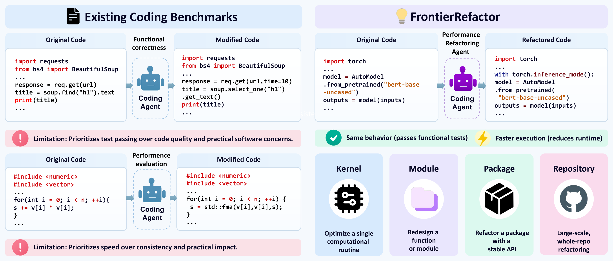
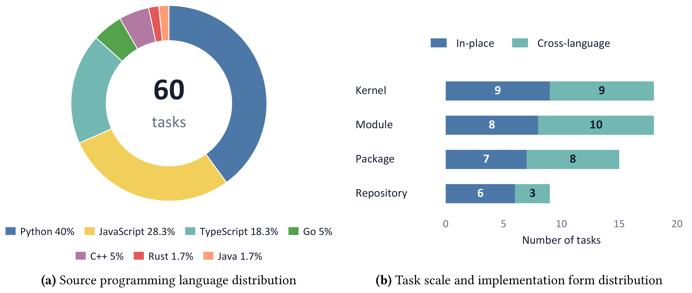
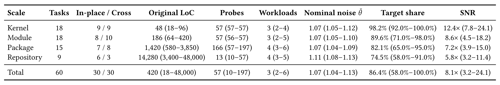

<div align="center">

# FrontierRefactor

### Benchmarking Multi-Scale Performance-Oriented Codebase Refactoring

📄 [Paper (PDF)](paper/frontier-refactor.pdf)


</div>

<p align="center">
  
</p>

**FrontierRefactor** asks a coding agent to make real software *faster* while keeping its externally observable behavior *exactly* the same. A submission counts only if it passes every behavioral probe **and** its worst-case speedup clears a calibrated hardware noise floor.

Existing benchmarks evaluate these two requirements in isolation: refactoring benchmarks check functional correctness and ignore runtime regressions, while performance benchmarks target isolated micro-kernels. FrontierRefactor formalizes refactoring scale through the **observable contract**, the caller-visible interface that fixes behavior while leaving the implementation free to change, and spans four scales from computational kernels to full repositories, in two forms: **in-place optimization** and **cross-language rewriting**.

## ✨ Highlights

- **60 qualified tasks** from public open-source repositories, across **4 contract scales** and **7 source languages**, split evenly between in-place optimization (30) and cross-language rewriting into Rust or Go (30).
- **Reference-free, cascaded evaluation**: compliance → functional equivalence (zero partial credit) → noise-calibrated speedup. No human reference patch caps the achievable score.
- **Amdahl-qualified**: targeted components dominate baseline runtime, probes are deterministic across repeated runs, and timing noise is calibrated per task.
- **Held-out evaluation**: the agent receives only the codebase and its contract; the functional probes and benchmark workloads are withheld by the evaluation harness.

## 🧩 The Benchmark

### Four contract scales

| Scale | Tasks | Observable contract | What the agent may redesign |
|---|:---:|---|---|
| **Kernel** | 18 | a single computational routine | local instruction scheduling and memory layout |
| **Module** | 18 | function signatures | algorithms and data structures |
| **Package** | 15 | public API | the whole package, including the host language |
| **Repository** | 9 | top-level CLI, streams and filesystem artifacts | the whole system |

<p align="center">
  
</p>
<p align="center"><sub><b>Dataset composition.</b> (a) Source programming languages of the 60 tasks. (b) Tasks per scale, split into in-place optimization and cross-language rewriting.</sub></p>

<p align="center">
  
</p>
<p align="center"><sub><b>Statistics per scale.</b> Original LoC and probes: median (range). Nominal noise θ̄: median 99th percentile of baseline self-speedup under null calibration. Target share: share of baseline runtime spent in the targeted component. SNR: achievable speedup over null spread.</sub></p>

Cross-language tasks rewrite the original code into Rust (18 tasks) or Go (12 tasks).

### Evaluation protocol

A candidate $S'$ is compared against the original codebase $S$ through three gates, in order:

| Gate | Passes when |
|---|---|
| **Compliance** $G_{\text{comp}}$ | $S'$ uses only permitted dependencies and no prohibited symbols |
| **Functionality** $G_{\text{func}}$ | $S'(x) \equiv S(x)$ for every held-out probe $x$: return values, exceptions, standard streams, exit codes |
| **Performance** $G_{\text{perf}}$ | the worst-case speedup over the benchmark workloads, $r(S') = \min_{d} \frac{\text{Runtime}(S,d)}{\text{Runtime}(S',d)}$, clears the noise threshold $\theta_{\text{trial}}$ |

**Strict success** requires all three gates. Every attempt falls into exactly one outcome: *Compliance Failure*, *Functional Failure*, *Slower* ($r < 1$), *Noise-Bound* ($1 \le r \le \theta_{\text{trial}}$), or *Strict Success*.

### Task layout

Every task is a self-contained [Harbor](https://harborframework.com) task:

```
tasks/<scale>/<task>/
├── task.toml          # scale, form, languages, upstream URL + commit, license, resource limits
├── instruction.md     # the task statement shown to the agent
├── environment/       # what the agent works on: the original code, run.sh, Dockerfile (build.sh for cross-language tasks)
├── tests/             # held out from the agent: verify.py, frozen expectations, the reference implementation
└── LICENSE.upstream   # license of the upstream project
```

Expected outputs are frozen captures of the original program's own behavior, distilled over repeated runs so that only reproducible behavior is graded; none is hand-written. During grading, the verifier runs the submission and the reference as separate users with no network access, and refuses to grade if any of these isolation checks fails.

## 🚀 Quick Start

The runner creates one [E2B](https://e2b.dev) sandbox per run, installs Harbor inside it, runs the agent and the verifier, and copies all outputs back. Each sandbox has 8 vCPUs and 8 GB of memory and may need to stay alive for several hours (the agent timeout is 4 h; `--lifetime` defaults to 7 h), so your E2B plan must allow custom template sizes and long-lived sandboxes.

**1. Install the client dependency** (Python 3.10+ on Linux or macOS; Harbor itself is installed inside each sandbox)

```bash
pip install -r requirements.txt
```

**2. Build the sandbox template (once)**

Tasks need root, mount and chroot for verifier isolation, so they run in a Docker-in-Docker template ([`scripts/e2b-dind/Dockerfile`](scripts/e2b-dind/Dockerfile)):

```bash
export E2B_API_KEY=...
python3 scripts/create_dind_template.py      # 8 CPUs / 8 GB; prints E2B_DIND_TEMPLATE=<id>
export E2B_DIND_TEMPLATE=<id>
```

**3. Run**

```bash
export ANTHROPIC_API_KEY=...                  # claude-code;  use OPENAI_API_KEY for codex

python3 scripts/run_benchmark_e2b.py tasks/ \
    --agent claude-code --model claude-opus-5 \
    --ak reasoning_effort=high --ak version=2.1.278 \
    --repeat 3 --concurrency 16 \
    --json opus.json --harvest-dir results/
```

The agent settings (harness version, `reasoning_effort=high`, 3 trials) are the ones used in the paper. For OpenAI models use `--agent codex --ak version=0.155.1`.

Useful selectors: `--scale kernel`, `--only <task>` or `--only <scale>/<task>` (repeatable), `--limit N`. Credentials can also be placed in a `.env` file at the repository root.

**Ablation subset.** [`ablation_tasks.jsonl`](ablation_tasks.jsonl) lists the 25 tasks used for the reasoning-effort ablation and the multi-turn feedback study.

### Output

Each run is copied back to `results/<model>/<scale>/<task>/rep<N>/jobs/check/<trial>/`:

| File | Content |
|---|---|
| `verifier/reward.json` | `correct`, `correctness_passed` / `correctness_total`, `speedup`, `reward` |
| `verifier/correctness-detail.json` | timing evidence per workload, including the noise floor, and the isolation checks |
| `agent/trajectory.json` | the agent's trajectory: steps, tool calls, token usage |
| `artifacts/app/` | the submitted code |
| `result.json` | trial metadata: agent and model versions, timings |

The run report (`--json`) has one record per run. A run with zero agent actions, or one that ended on a model-API error, is marked as failed: the untouched starting code of an in-place task already passes the verifier, so such a run would otherwise look like a success.

## 📝 Citation

```bibtex
@misc{wang2026frontierrefactor,
  title  = {FrontierRefactor: Benchmarking Multi-Scale Performance-Oriented Codebase Refactoring},
  author = {Wang, Shijian and Meng, Fanqing and Chen, Jiajun and Chen, Qiguang and Song, Linxin and Fu, Runhao and Zheng, Shuhang and Shao, Shuai and Xie, Qizhe and Zhao, Jieyu and Hu, Mengkang},
  year   = {2026},
  url    = {https://github.com/evolvent-ai/FrontierRefactor}
}
```
